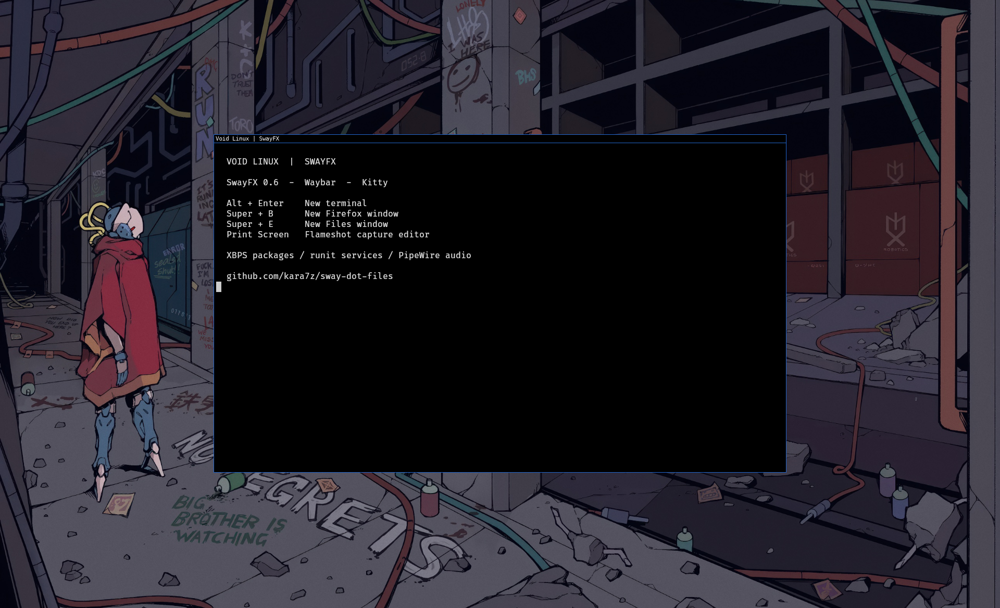

# Void Linux / SwayFX

This profile snapshots the working Void Linux desktop from 2026-11-05.
The original Arch/CachyOS configuration remains the base profile.

## Install

```sh
git clone https://github.com/kara7z/sway-dot-files.git
cd sway-dot-files
./install-void.sh --check
./install-void.sh --all
```

`install.sh` also detects Void via `/etc/os-release`. Select explicitly with
`--profile void` or `--profile arch`. Copy/symlink modes, timestamped backups,
`--offline`, and `--target-home` work with either profile. `--check` never installs
packages, builds helpers, or changes files. `--offline` applies to Cargo builds;
dependency installation still needs network access.

XBPS package names are in [`deps/xbps.txt`](../deps/xbps.txt). The installer
does not enable services or replace your display manager/session configuration.
Run it as your normal user, not root; sudo is used only for packages.

## Session and services

Start SwayFX as `dbus-run-session sway`, either from a TTY or your display manager.
Enable the Void `dbus` and `elogind` runit services if not already running.
Enable `NetworkManager`, `bluetoothd`, and `power-profiles-daemon` if you use
their corresponding desktop features. Do not run competing network managers:
review existing dhcpcd/wpa_supplicant services before switching to NetworkManager.
Consult the Void Handbook for your service setup; no systemd is required.

`sway-void-startup` imports the session's D-Bus environment, starts PipeWire and
the GNOME polkit agent, and restores the wallpaper. Included PipeWire snippets
start WirePlumber and the PulseAudio-compatible server. Avoid starting duplicate
audio services elsewhere. Power-menu actions use elogind's `loginctl`.

## Suspend and resume (elogind + runit)

Let elogind own lid and sleep-button events. The `sway-idle-lock` helper runs one
`swayidle -w`, locks before sleep, locks after five idle minutes, and blanks
outputs after ten. Output blanking is not system suspend. Use `loginctl suspend`
for suspend so elogind coordinates the locker, NetworkManager and sleep hooks.

If acpid is also enabled, inspect `/etc/acpi/events/` and
`/etc/acpi/handler.sh`: the default handler can call `zzz` on lid close and the
sleep button while elogind handles the same events. These independent paths
can race; `zzz` also bypasses elogind's delay inhibitors. Keep acpid if other
ACPI actions need it, but remove only its duplicate lid/sleep actions.
The dotfile installer deliberately does not modify this root-owned file.

Before editing, confirm elogind is running and back up the handler:

```sh
sudo sv status /var/service/elogind /var/service/dbus /var/service/acpid
backup="/etc/acpi/handler.sh.bak.$(date +%Y%m%d-%H%M%S)"
sudo cp -a /etc/acpi/handler.sh "$backup"
printf 'Backup: %s\n' "$backup"
sudoedit /etc/acpi/handler.sh
```

In the handler's outer `case "$1" in`, replace the existing `button/sleep)` and
`button/lid)` branches (including their nested cases) with these no-op branches;
leave all other actions unchanged:

```sh
    button/sleep)
        # elogind coordinates locking, networking and sleep hooks.
        ;;
    button/lid)
        # elogind also applies the docked-lid policy.
        ;;
```

Validate with `sh -n /etc/acpi/handler.sh`. No service restart or reboot is needed:
acpid invokes the handler for each event. Restore the recorded backup with
`sudo cp -a "$backup" /etc/acpi/handler.sh` to undo the change. Keep elogind's
lid/sleep handling enabled when using this arrangement.

Read-only diagnostics (no systemd commands):

```sh
cat /sys/power/state /sys/power/mem_sleep
grep -H . /sys/power/suspend_stats/*
sudo dmesg --ctime | tail -160
elogind-inhibit --list
```

Do not force `deep` if `/sys/power/mem_sleep` lists only `[s2idle]`. Do not
disable GPU drivers, networking or login services merely because suspend reports
`Device or resource busy`; use the logs to identify the actual failure.

Local verification on 2026-11-07: Dell Precision 5490, kernel `6.18.60_1`,
Intel i915 and NVIDIA open driver `595.112.07`, s2idle only. After removing the
duplicate acpid actions, one explicitly approved `loginctl suspend` test completed:
kernel counters showed one success and zero failures, Sway and the login session
remained active, and Wi-Fi reconnected. NVIDIA emitted an ACPI D-Notifier warning
on resume without failing this test. The original failure was not retained in
the current boot's logs, so the duplicate handling is a confirmed configuration
conflict, not proof of the original error's sole cause. Lid-triggered suspend and
long-term reliability have not been separately verified. Save work and obtain
permission before running another suspend test.

## Wallpaper picker and appearance

Waypaper is not currently in the Void package list. To use the included launcher:

```sh
python3 -m venv --system-site-packages ~/.local/share/venvs/waypaper
~/.local/share/venvs/waypaper/bin/pip install 'waypaper==2.9'
```

Bibata Modern Ice and a complete FiraCode Nerd Font are optional manual font/cursor
installations. The XBPS list provides FiraCode and Nerd Font symbols as fallbacks;
adjust `font_family` in Kitty if necessary. Discord is optional and must be
installed separately; it is not downloaded automatically.

## Local adaptations

- SwayFX effects live in `~/.config/sway/effects.conf`; animations are 250 ms.
- Blur stays enabled for the desktop, with Kitty and game exclusions.
- Kitty uses an opaque background and a normally started shared instance.
  The earlier hidden instance produced gray windows; it is not prestarted.
- Alt+Enter opens a new Kitty window. Super+B opens a new Firefox window via
  its D-Bus remote interface, falling back to `firefox --new-window`.
- Super+E requests a new Nautilus window via D-Bus, not just focus-existing.
- Print Screen opens Flameshot's graphical selection/annotation editor using
  its Grim adapter. No portal changes are needed for this capture path.
- `way-displays` uses Void 1.14's sequence-based v1 configuration schema.
  Display settings open `wdisplays`; review the eDP-1/1920×1200 display snapshot
  in `profiles/void/sway/output.conf` and `profiles/void/way-displays/cfg.yaml`
  before use on different hardware.
- The optional Firefox fast launcher uses Python's system PyGObject/GIO;
  the common Sway/Waybar helpers remain compiled Rust.

After installation, validate with `sway -c ~/.config/sway/config --validate`.
Log out and back in to run new `exec` startup commands. A reload only reruns
`exec_always`. Do not enable the SwayFX effects include in plain Sway.

## Screenshot



The preview is a clean desktop capture; personal browser tabs, terminal history,
and network details are excluded.
